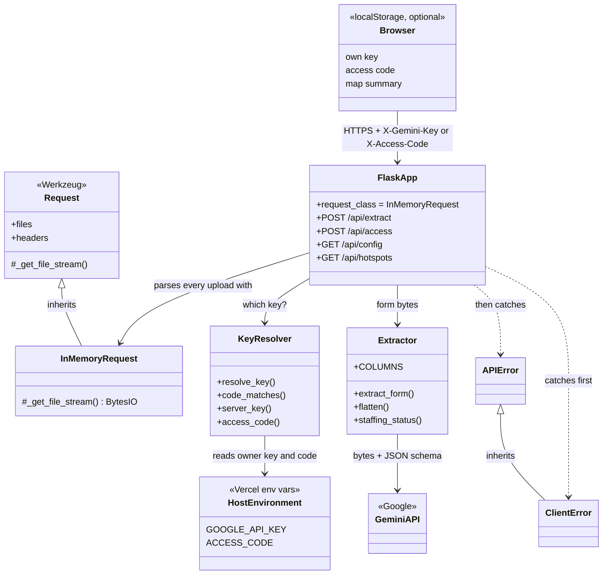
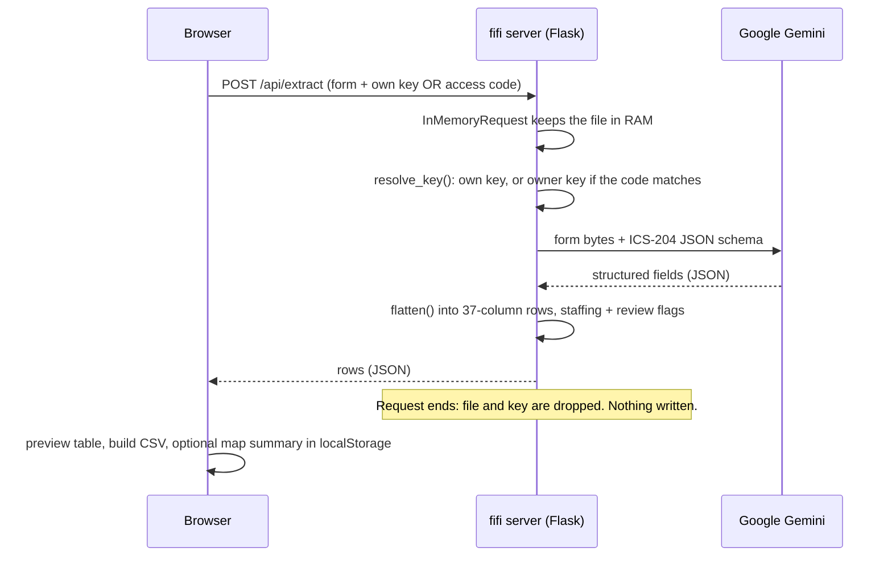

# 🔥 fifi — Fire Incident Form Intelligence

**Live:** https://fifi-tan.vercel.app

A web app that turns **ICS-204 Assignment List forms** into a clean, sortable **CSV**, and places those incidents on a **live map of US wildfires**.

Upload photos, scans or PDFs of ICS-204 forms (typed or handwritten). Google Gemini reads every field (incident info, supervisors, resources, tasks, comms and approvals), and the site shows the results in a table you can download as one combined CSV.

**Built with:** Python · Flask · Google Gemini API (structured JSON output) · MapLibre GL JS · vanilla JavaScript · Vercel

## Fire Ops (`/ops`)

A full-screen operations view of the same live data, plus the weather that drives fire behavior. Inspired by [God's Eye View](https://github.com/bilawalsidhu/gods-eye-view). Everything is keyless.

| Feature | What it does | Source |
|---|---|---|
| **Live wind** | Animated particles show 10 m wind across whatever you're looking at, refetched as you pan | Open-Meteo (13×9 grid per view) |
| **Click-to-track** | Click any fire: the camera dives in 3D and turns to face downwind, with 5/10/25 km range rings | NIFC WFIGS |
| **Briefing panel** | Size, containment, personnel, cost; VIIRS heat near the fire (count, total and peak MW, an hourly chart, night detections); 24 h fire-weather chart with critical hours shaded | NIFC, NASA FIRMS, Open-Meteo |
| **Critical fire weather** | Flags hours with RH ≤ 15% and gusts ≥ 25 mph (Red-Flag-like) or RH ≤ 25% and gusts ≥ 20 mph (elevated) | Open-Meteo hourly |
| **Spread envelope** | Illustrative +3/6/12/24 h free-run ellipses from forecast wind and humidity. A heuristic for visualization, not a fire-behavior model (no fuels, slope or suppression) | computed in the browser |
| **Places downwind** | Named towns and villages inside the 24 h envelope, with distance and direction | OpenStreetMap via Photon, with Overpass as a fallback |
| **Smoke** | US AQI and PM2.5 at the fire and 25 km and 60 km downwind | Open-Meteo air quality (CAMS) |
| **Fire weather watchlist** | The 40 largest fires under 90% contained, ranked by a surface Hot-Dry-Windy Index (vapor pressure deficit × wind) | Open-Meteo, one batched call |
| **Red Flag Warnings** | Active Red Flag Warnings and Fire Weather Watches as polygons (zone-based alerts are resolved to zone shapes) | NWS API |
| **Radar, infrared, lightning** | MRMS radar, GOES longwave infrared and lightning density overlays | NOAA nowCOAST WMS |
| **3D terrain** | Hillshade plus terrain with 1.5× exaggeration | Mapzen terrain tiles on AWS Open Data |
| **24 h replay** | Scrub or play the last 24 hours of VIIRS detections; the newest 90 minutes flare as they appear | NASA FIRMS (via `/api/hotspots`) |
| **SITREP & links** | Copy a plain-text situation report, or a link that reopens the tracked fire (`/ops#fire=<id>`) | — |

Keys: **W** wind · **T** terrain · **R** replay · **O** orbit the tracked fire · **/** search · **Esc** stop tracking.

## Live fire map

The landing page (`/`) shows a live operating picture, built entirely from public, keyless feeds:

| Layer | Source | Notes |
|---|---|---|
| Incidents | NIFC WFIGS current incident locations | Sized by acres, colored by containment. Popups show personnel, complexity, cause, behavior and estimated cost. |
| Perimeters | NIFC WFIGS current interagency perimeters | Simplified to ~100 m for a light payload |
| Satellite hotspots | NASA FIRMS VIIRS, NOAA-20 + NOAA-21, trailing 24 h | Colored by fire radiative power. Heatmap at continental zoom, points up close. Relayed by `/api/hotspots`. |
| Your ICS-204s | Your own extractions, kept in your browser | Matched to the national feed by incident name; gold ring plus your form totals in the popup |
| Imagery | Esri World Imagery | Optional basemap |

Filters: wildfire / prescribed, minimum acres, state, name search, hide contained, minimum fire power (MW) and detection confidence. One filter pass drives the map, the list and every counter.

The fire-power color ramp, the intensity and confidence filters, and the heatmap-to-points crossfade are adapted from the MIT-licensed [God's Eye View](https://github.com/bilawalsidhu/gods-eye-view).

## Behind the scenes: APIs and data sources

| Source | What it is, simply | What fifi uses it for | Key? |
|---|---|---|---|
| **Google Gemini API** | Google's AI. fifi sends a form photo plus a template of the fields to fill. | Reads each ICS-204 into structured fields (Flash for the public, Pro for access-link users) | Yes: the visitor's, or the owner's via access link |
| **NIFC WFIGS** | The National Interagency Fire Center's public wildfire map data (ArcGIS REST API, GeoJSON) | **Incidents**: one dot per current fire with acres, % contained, personnel, cause, cost. **Perimeters**: each fire's outline, smoothed to about 100 m so it loads fast. | No |
| **NASA FIRMS (VIIRS)** | Heat spots seen by the VIIRS sensor on the NOAA-20 and NOAA-21 weather satellites, last 24 hours | **Hotspots**, colored by fire radiative power (MW, how hot). A glow when zoomed out, dots up close. | No |
| **MapLibre GL JS** | Free, open-source map library | Draws the interactive map in the browser | No |
| **CARTO / OpenStreetMap** | Dark background map with roads, borders and place names | The map's base layer | No |
| **Esri World Imagery** | Satellite photos | Optional photo background | No |
| **Vercel** | Hosting | Runs the Python server, serves pages from its CDN, stores the owner's key and access code securely | — |

**fifi's own API**

| Endpoint | What it does |
|---|---|
| `POST /api/extract` | Takes one form, has Gemini read it, returns rows plus usage (tokens, time, cost) |
| `POST /api/access` | Checks a private access code |
| `GET /api/config` | CSV column order, upload limit, models and prices in use |
| `GET /api/hotspots` | Relays NASA's satellite file. Browsers can't load it directly, so the server fetches it, slims it down and caches it for 15 minutes. |

In one line: **Gemini reads the forms, NIFC supplies fire locations and outlines, NASA satellites supply heat detections (relayed by fifi's server), MapLibre draws it all, and Vercel hosts it.**

## Security & privacy

- **No storage:** there is no database and no file storage. Uploaded forms are held **in memory only** for the request (`InMemoryRequest` in `app.py` stops Werkzeug spooling large uploads to disk), then discarded.
- **Visitor keys:** sent per request in `X-Gemini-Key`, used for that one Gemini call, never logged or saved. Kept in the visitor's browser only if they tick "Remember on this device".
- **Private access:** the owner's key is a host environment variable and never reaches the browser; only the access code does.
- **Results stay client-side:** the CSV is built in the browser, and the map summary lives in the browser's `localStorage` until cleared.
- **Google:** Gemini necessarily receives each form. On free-tier keys Google may use content to improve its products; paid keys are not used for training. Use a paid key for confidential IAPs.

---

## Engineering overview

### The problem, in one paragraph

On a wildfire, each operational period produces an **Incident Action Plan (IAP)**. Its **ICS-204 Assignment List** says, per division, which crews and engines are assigned, how many people each has, the task, and the radio channels. It's printed, carried on the line, and corrected by hand, so it's hard to total up or search. **fifi** reads photos of those forms with AI, turns each one into rows in a spreadsheet, flags understaffed resources, and shows the incident on a live national fire map.

### User pain points (why fifi exists)

| Pain point | What it costs | How fifi helps |
|---|---|---|
| ICS-204s are **paper**, often photographed on a phone | Someone retypes them by hand, which is slow and error-prone | Snap a photo; AI fills the spreadsheet |
| Forms are **corrected by hand** (crossed-out names, red-ink swaps) | Typed copies fall out of date; handwriting is hard to read | Gemini reads handwriting and corrections |
| Each division has its **own page** | No quick way to total people or resources across the incident | All forms merge into one CSV with the same 37 columns |
| **Understaffed crews** are buried in the table | A one-person resource is easy to miss | Automatic `CRITICAL` / `NO_PERSONNEL` flags and an "understaffed" count |
| **Radio channels** are scattered across forms | The comms unit compiles them by hand | Channels come out as their own rows |
| No link between the form and the **bigger picture** | You can't see the fire's size, containment or perimeter alongside your staffing | Your incident shows on a live national fire map |
| Forms can hold **personal information** | Teams avoid tools that store documents | Nothing is stored: memory only, no database |

### Functional requirements (what it does)

| # | Requirement | Where |
|---|---|---|
| F1 | Upload one or many forms by **drag and drop or file browse** (JPG, PNG, WEBP, PDF) | `extract.html` |
| F2 | **Read the form (OCR + understanding)** with Gemini, including handwriting, into a fixed JSON schema | `ics204_extractor.py` |
| F3 | **Flatten** each form into one row per resource plus one row per radio channel, all with the same 37 columns | `flatten()` |
| F4 | **Flag staffing** per resource: `OK`, `CRITICAL`, `NO_PERSONNEL` | `staffing_status()` |
| F5 | **Preview** results in a table before saving | `extract.html` |
| F6 | **Download** one combined CSV that opens cleanly in Excel or Google Sheets | `extract.html` (`toCsv`) |
| F7 | Access with **your own Gemini key** or a **private access link** | `app.py` (`resolve_key`) |
| F8 | **Retry only the forms that failed** | `extract.html` |
| F9 | **Live fire map** of incidents, perimeters and satellite hotspots, with filters | `index.html`, `/api/hotspots` |
| F10 | **Match extracted incidents** to the live map and show your form totals | `index.html` (`matchMine`) |
| F11 | **Clear** your saved key and map data from the device | both pages |
| F12 | **Whole-IAP PDFs:** find the ICS-204 pages (built-in text, or free OCR for scans), skip the rest, let the user override | `extract.html` (`analyzePdf`, `classifyPage`) |
| F13 | **Human-review flags:** mark rows whose handwriting Gemini found uncertain or illegible, with a note; highlight and filter them | schema + `review_flags()`, `extract.html` |

### Non-functional requirements (how well it does it)

| Quality | Target | Measured / how |
|---|---|---|
| **Speed** | Average under 15 s per page | **Met on the public site:** Flash averages 8.9 s. **Not met for access-link users:** Pro HIGH averages 25.6 s, a deliberate trade for reliable review flags (see pain point 15). |
| **Cost efficiency** | Pay only for ICS-204 pages | In a whole-IAP PDF, other forms are detected in the browser for free and never sent (test: 8-page IAP → 3 Gemini calls) |
| **Trustworthy output** | Never guess silently | Hard handwriting is flagged for human review instead of being quietly filled in |
| **Cost transparency** | Users see what AI they use and what it costs | Every result shows model, tokens, time and estimated cost (see [Transparency](#transparency-models-api-calls-and-cost)) |
| **Reliability** | Never hang; clear errors | Each Gemini call is capped at 240 s (host limit 300 s). Friendly messages for a bad key, rate limit or timeout. |
| **Security: API key** | Never stored on the server | Sent per request in a header, used once, never logged. The owner's key lives only in host environment variables. |
| **Security: documents** | Confidential forms never kept | No database. Uploads stay in RAM only (`InMemoryRequest`) and are gone when the request ends. |
| **Usability** | No install, no account, no training | One page: paste key, drop files, press Extract. Works on phone and desktop. |
| **Cost** | Owner doesn't pay for strangers | Visitors bring their own key. Only access-link users spend the owner's key. |
| **Upload limits** | Phone photos just work | Photos are shrunk in the browser to under 4 MB before upload. |
| **Maintainability** | Small and simple | 2 Python dependencies, 2 HTML pages, no build step. |

Simple wireframe of the extractor page:

```
┌──────────────────────────────────────────────────┐
│ 🔥 fifi // fire incident form intelligence   Map │
├──────────────────────────────────────────────────┤
│ 1 · YOUR GEMINI API KEY                          │
│ [ •••••••••••••••••••••••• ] [Show]              │
│ ☐ Remember on this device   (or: ✓ access link)  │
├──────────────────────────────────────────────────┤
│ 2 · UPLOAD ICS-204 FORMS        JPG PNG WEBP PDF │
│ ┌──────────────────────────────────────────────┐ │
│ │      📋  Drag & drop forms here, or browse   │ │
│ └──────────────────────────────────────────────┘ │
│  div-a.jpg ............ ✓ 23 rows             ×  │
│  div-b.pdf ............ ⟳ Reading…            ×  │
│ [Extract data] [Download CSV] [Clear]            │
├──────────────────────────────────────────────────┤
│ 3 · EXTRACTED DATA   Forms 2 · Rows 41 · Short 9 │
│ ┌ incident │ division │ resource │ people │ status│
│ │ HOPE     │ DIV A    │ E-2102   │ 2      │ OK    │
└──────────────────────────────────────────────────┘
```

### SDLC: Agile, in sprints

fifi was built in short sprints. Each one ended with something working that could be shown and judged, especially **what the exported CSV should contain**.

| Sprint | Goal | What changed in the CSV |
|---|---|---|
| 1 | Command-line prototype: photos → plain text, then a JSON schema → Excel/CSV | First columns: `source_image`, incident header, resources, `status` |
| 2 | Batch processing for real forms: rate-limit retries, handwriting flags, confidence scores | Tried `confidence_score`, `requires_human_review` and a 4-level staffing scale |
| 3 | First web app (Flask): upload, preview, download | Communications rows added (`comm_*` columns) |
| 4 | Make it safe and fast for the public: bring-your-own key, one form per request, CSV built in the browser | **Fixed 33 columns on every row**; `source_image` → `source_file`; bug fix so 0 people shows `NO_PERSONNEL` |
| 5 | Deploy (Vercel) plus a private access link for a professor; fix model and speed | No schema change; Flash/Pro split, LOW thinking (10x faster, same output) |
| 6 | Live fire map, landing page, security section | Map summary built from CSV rows (resources, people, understaffed) |
| 7 | Whole-IAP PDFs, human-review flags, cost transparency | Added `needs_review`, `legibility`, `review_note`, `form_review_note` (**37 columns**) |

Each sprint followed **plan → build → test with real forms → review → adjust the backlog**. Example user stories:
- *As a planning chief, I want one row per resource, so I can sort the whole incident by staffing.*
- *As a comms unit leader, I want radio channels as their own rows, so I can build a frequency list.*
- *As a professor, I want a link that just works, so I don't need my own API key.*

### Architecture style: MVP (Model–View–Presenter)

In plain words, the app is split into three jobs:

| Part | Job | In fifi |
|---|---|---|
| **Model** | The data and the rules. Knows nothing about screens. | `ics204_extractor.py` (schema, Gemini call, flattening, staffing rules), the API in `app.py`, and the outside data feeds (Gemini, NIFC, NASA FIRMS) |
| **View** | What you see. Shows things and passes on clicks. No logic. | The HTML and CSS in `public/index.html` and `public/extract.html` (drop zone, table, map, legend) |
| **Presenter** | The middleman. Reacts to clicks, asks the Model for data, and tells the View what to show. | The JavaScript in each page: handles uploads, calls `/api/extract`, tracks each file's state, filters the map, builds the CSV |

Example: you press **Extract** (View) → the Presenter shrinks the photo and sends it to `/api/extract` → the Model reads it with Gemini and returns rows → the Presenter updates the file list and table (View).

The whole thing is also **client–server** with a **stateless serverless backend**: every request carries everything it needs, and the server remembers nothing afterward. That's what makes the "nothing stored" promise possible.

*(MVP also means "minimum viable product", and fifi started as one: the smallest working tool, then improved sprint by sprint.)*

### UML: how key handling and document security fit together

**Inheritance** is used where it matters most for security. `InMemoryRequest` is a subclass of Werkzeug's `Request` and overrides one method so uploaded files go to RAM instead of a temporary file on disk. Flask is told to use it for every request. Error handling also relies on inheritance: Gemini's `ClientError` is a subclass of `APIError`, so the specific case (bad key, rate limit) is caught first and the general one after.



One extraction, step by step:



### Languages and tools

| Area | Tools |
|---|---|
| **Languages** | Python 3.12 (server), JavaScript (browser logic), HTML and CSS (pages) |
| **Backend** | Flask (web framework), Werkzeug (request handling, subclassed), `google-genai` SDK (Gemini), `certifi` (HTTPS certificates) |
| **AI models** | Google Gemini: `gemini-3.8-flash` (visitors' own keys), `gemini-3.1-pro-preview` (access-link users), with structured JSON output |
| **Map** | MapLibre GL JS 4.7.1, CARTO Dark Matter basemap, Esri World Imagery |
| **PDF handling (in the browser)** | PDF.js 4.10.38 (reads and renders PDF pages), Tesseract.js 5.1.1 (free OCR on scanned page headers) |
| **Live data** | NIFC WFIGS (incidents and perimeters, ArcGIS REST), NASA FIRMS VIIRS (satellite hotspots) |
| **Hosting** | Vercel (serverless Python, CDN, encrypted environment variables, auto-deploy on push) |
| **Source control** | Git, GitHub |
| **Dev tools** | Cursor (first version), Claude Code (AI pair programming), VS Code, curl, headless Chrome / Puppeteer (UI checks) |
| **Fonts** | Space Grotesk, JetBrains Mono (Google Fonts) |
| **Earlier versions** | pandas, Pillow, openpyxl (removed: the browser now builds the CSV and resizes photos) |

### Choosing the OCR engine (a big part of the project)

Much of the early time went into testing which tool reads ICS-204s best. An ICS-204 is hard for OCR: it's a **table**, it mixes **print and handwriting**, entries get **crossed out and replaced**, and photos are taken at angles on a phone. What mattered was not just reading the words, but getting them into the **right fields**.

| Family | Tools looked at | Good at | Why it didn't fit ICS-204 |
|---|---|---|---|
| **Open-source OCR** | Tesseract (pytesseract), EasyOCR, PaddleOCR (incl. PP-Structure for tables), docTR, Kraken | Free, runs offline, solid on clean printed text | Returns loose words and boxes. Weak on handwriting and crossed-out entries. Rebuilding the table and mapping words to fields needs a lot of custom code. |
| **Open-source document models** | TrOCR (handwriting), Surya (layout + OCR), Donut (OCR-free document understanding) | Better handwriting or layout awareness | Need GPU and fine-tuning on ICS-204 examples to fill our exact fields. Too heavy for a small project and a free serverless host. |
| **Vision LLMs** | OpenAI GPT vision models, Anthropic Claude, Google Gemini, Mistral OCR, open models such as Qwen-VL and Llama Vision | Read handwriting *and* context ("this number is the crew size"), and fill a JSON schema directly | Cost per call and occasional misreads. Mitigated with a fixed schema and human review. |
| **Cloud document AI** | **Amazon Textract** (Forms + Tables), Google Document AI (Form Parser), Azure AI Document Intelligence | Industrial-scale, accurate forms and tables, built for millions of pages | Overkill for a few ICS-204 pages: cloud account, IAM roles and storage buckets to set up, per-page billing, and you still write code to map generic key-value pairs onto ICS-204 fields. |

**Decision: Google Gemini with structured output.** One API call turns a photo directly into JSON in the exact ICS-204 shape, handwriting included. It has a free tier for public visitors and a stronger Pro model for invited users, and needs no GPU, no cloud setup and only one Python library. The first prototype (`image_text_extractor.py`, now removed) used Gemini for plain-text OCR. That lost the table structure, which is what led to the schema approach used today.

### Transparency: models, API calls and cost

Measured on four real ICS-204 photos (5–23 rows each). Prices are Google's paid-tier rates from the [Gemini API pricing page](https://aistudio.google.com/docs/pricing), read 12 Nov 2026.

| | Public site (visitor's own key) | Private access link (owner's key) |
|---|---|---|
| Model | `gemini-3.8-flash`, LOW thinking | `gemini-3.1-pro-preview`, HIGH thinking |
| Gemini calls | **1 per ICS-204 page** (other pages: 0) | **1 per ICS-204 page** (other pages: 0) |
| Average time per page | 8.9 s (range 6.7–11.2 s) | 25.6 s (range 15.3–34.9 s) |
| Tokens per page | 1,339 in (same for every photo) · 503–1,706 out | 1,339 in · 1,900–6,621 out (includes thinking) |
| Price per 1M tokens | $0.75 in · $3.75 out (doubles on 1 Jan 2027) | $2.00 in · $12.00 out |
| Cost per page | **≈ $0.005** (0.3–0.7¢), about 190 pages per $1 | **≈ $0.055** (2.5–8.2¢), about 18 pages per $1 |
| Free tier | **Yes ($0)**, but Google may use free-tier content to improve its products | **No**: always billed to the key owner |

**What calls happen when:**

| Action | Calls | Gemini calls |
|---|---|---|
| Open the landing page | 2 to NIFC (incidents, perimeters) + 1 to `/api/hotspots`, which asks NASA at most once every 15 minutes | 0 |
| Open an access link | 1 code check (`/api/access`) | 0 |
| Add a PDF or whole IAP | Pages are sorted in the browser (built-in text, or Tesseract.js OCR for scans). Non-ICS-204 pages are never sent. | 0 |
| Extract ICS-204 pages | 1 upload → 1 Gemini call per page. Pages go one at a time, so a visitor makes at most about 6 calls per minute. | **1 per page** |
| Preview, download CSV, view on map | Done in the browser from results already received | 0 |

**Rate limits:** Google doesn't publish fixed per-minute limits for these two models. They depend on the key's usage tier (Free, Tier 1–3), are shown in [AI Studio](https://aistudio.google.com/rate-limit), reset daily at midnight Pacific time, and are tighter for preview models. When a limit is hit, fifi shows "rate limit reached, wait a minute" and only the failed forms are retried.

**Live in the app:** every extraction returns its own `usage` (model, tokens in/out, seconds, estimated cost), and the extractor shows the running totals. `GET /api/config` publishes the models and prices in use.

---

## How it works

1. **Get access, either way:**
   - **Bring your own key:** visitors paste their own free [Gemini API key](https://aistudio.google.com/apikey). It's sent only with their own requests (in the `X-Gemini-Key` header) and is never stored on the server. They can choose to remember it in their own browser.
   - **Private access link:** people you trust open `https://your-site/?access=YOUR_CODE` and use the site owner's key with no setup. The code is checked on the server and remembered in their browser, and the owner's key never leaves the server. See [Private access](#private-access).
2. **Upload:** drag and drop forms (`.jpg`, `.png`, `.webp`, `.pdf`). Large photos are resized in the browser before upload, so phone pictures work fine.
   - **Whole IAP PDFs:** the browser reads each page with PDF.js. Pages with built-in text are checked for ICS-204 markers ("ASSIGNMENT LIST", "Resources Assigned", "Drop off / Pick up", …); scanned pages get free OCR (Tesseract.js) on just the header and footer. Only ICS-204 pages are selected, shown as a page picker you can override, and each is sent as a compressed image. Non-204 pages are never uploaded.
3. **Extract:** pages are sent one at a time to Gemini with a fixed ICS-204 JSON schema, so the output has the same structure every time. Gemini also confirms the page is an ICS-204 (a safety net) and rates the legibility of every row.
4. **Organize:** each form is flattened into **one row per resource**, plus one row per communications-plan entry. Every row carries the form's header info, so it still makes sense after sorting or filtering.
5. **Download:** the CSV is built in the browser from the results, so nothing is processed twice.

---

## Run it locally

Requires Python 3.10+.

```bash
git clone https://github.com/buahomy/fifi.git
cd fifi
python3 -m venv .venv && source .venv/bin/activate
pip install -r requirements.txt
python3 app.py
```

Open **http://localhost:8080** for the landing page and live map, or **http://localhost:8080/extract** to paste your Gemini key and extract forms.

Settings go in environment variables, or in a git-ignored `.env` file locally:

| Variable | Default | Purpose |
|---|---|---|
| `GOOGLE_API_KEY` / `GEMINI_API_KEY` | *(unset)* | The owner's key, used for private-access visitors |
| `ACCESS_CODE` | *(unset)* | Secret code that unlocks the owner's key. **Always set this when `GOOGLE_API_KEY` is set on a public site**; without it, every visitor uses the owner's key. |
| `GEMINI_MODEL` | `gemini-3.8-flash` | Model for visitors using their own key (free-tier friendly) |
| `GEMINI_THINKING` | `LOW` | Thinking level for that model. On Flash, `LOW` is about 10x faster than `HIGH` and matched it on test forms. |
| `OWNER_GEMINI_MODEL` | `gemini-3.1-pro-preview` | Model for private-access visitors using the owner's key |
| `OWNER_GEMINI_THINKING` | `HIGH` | Thinking level for the owner's model. `HIGH`: 25.6 s, ~$0.055 per page, review flags consistent (3/3 runs). `LOW`: 12.2 s, ~$0.024, same rows but flags caught hard handwriting only 2 of 5 runs. |
| `PORT` | `8080` | Local server port |
| `FLASK_DEBUG` | `0` | `1` enables auto-reload |

## Private access

To let specific people (a professor, a teammate) use your key without giving it to them:

1. Pick a long random code, e.g. `openssl rand -hex 12`.
2. On your host, set `GOOGLE_API_KEY` to your key and `ACCESS_CODE` to the code.
3. Send them `https://your-site/?access=THE_CODE`.

Opening the link checks the code, saves it in their browser, and removes it from the address bar. After that they can just visit the site normally. Everyone else still needs their own key. To cut off access, change `ACCESS_CODE` and redeploy.

Usage through the link is billed to your Gemini key, so share it only with people you trust.

## Deploy

The repo is ready for **[Vercel](https://vercel.com)**: import it at vercel.com/new, add the two environment variables above if you want private access, and deploy. Vercel detects the Flask app in `app.py` and serves the landing page at `/` and the extractor at `/extract`. A form usually takes 5–16 seconds. Each Gemini call is capped at 240 seconds, so a slow response returns a clear "try again" message before Vercel's 300-second limit.

It also runs on any host that supports Python (Render, Railway, Fly.io, Cloud Run) with `gunicorn app:app`.

---

## CSV columns

| Group | Columns |
|---|---|
| **Source** | `source_file` |
| **Incident** | `incident_name`, `operational_period`, `date_from`, `date_to`, `branch`, `division_group` |
| **Operations personnel** | `operations_chief`, `branch_director`, `div_group_supervisor`, `air_attack_supervisor` |
| **Resource** | `resource_designator`, `resource_leader`, `num_persons`, `resource_lwd`, `drop_off`, `pick_up` |
| **Work assignment** | `task`, `purpose`, `end_state`, `special_instructions` |
| **Communications** | `comm_function`, `comm_channel`, `comm_rx_frequency`, `comm_rx_tone`, `comm_tx_frequency`, `comm_tx_tone`, `comm_mode` |
| **Approval** | `prepared_by`, `approved_by`, `approval_date`, `approval_time` |
| **Analysis** | `status` |
| **Human review** | `needs_review`, `legibility`, `review_note`, `form_review_note` |

### `status` values

| Value | Meaning |
|---|---|
| `OK` | Resource has 2 or more personnel |
| `CRITICAL` | Resource has exactly 1 person |
| `NO_PERSONNEL` | Personnel count is 0 or missing |
| `NO_RESOURCES` | The form lists no resources |
| `COMMUNICATION` | Row is a communications-plan entry, not a resource |

### Human-review columns

| Column | Meaning |
|---|---|
| `legibility` | Gemini's judgment of that row's handwriting: `clear`, `uncertain` (best reading given) or `illegible` |
| `needs_review` | `YES` when legibility is `uncertain` or `illegible`; check the value against the paper form |
| `review_note` | What was unclear, e.g. `num_persons: 3 or 8, smudged` |
| `form_review_note` | Unclear header, work-assignment or approval fields on that page (same on every row of the page) |

These flags are the model's **self-assessment, not a measured probability**. In testing, a deliberately blurred form had its three handwritten rows flagged and its typed rows left `clear`, and Flash and Pro disagreed on exactly those flagged values. They can still miss errors, so spot-check.

---

## API

`POST /api/extract` takes `multipart/form-data` with one `file`, and optionally an `X-Gemini-Key` header. It returns `{"rows": [...], "model": "...", "usage": {"calls": 1, "seconds": 9.2, "tokens_in": 1164, "tokens_out": 1167, "est_cost_usd": 0.0052}, "needs_review": 0, "form_review_note": ""}`. A page that turns out not to be an ICS-204 returns 422 with `not_ics204: true` (and its usage, since the call was made).

```bash
curl -H "X-Gemini-Key: $GEMINI_KEY" -F "file=@form.jpg" http://localhost:8080/api/extract
```

Instead of `X-Gemini-Key`, a request can send `X-Access-Code` to use the owner's key (see [Private access](#private-access)).

`GET /api/config` returns the CSV column order, the upload size limit, and whether the server key needs an access code. `POST /api/access` (with `X-Access-Code`) returns 200 if the code is valid and 401 if not.

`GET /api/hotspots` returns NASA FIRMS VIIRS detections (NOAA-20 + NOAA-21, trailing 24 h, US + Hawaii) as compact arrays: `[lon, lat, frp_mw, confidence, acquired_utc, daynight, satellite]`. Cached for 15 minutes.

---

## Project structure: every file and what it's for

| File | What it does |
|---|---|
| `app.py` | The server. Serves the pages and the API (`/api/extract`, `/api/access`, `/api/config`, `/api/hotspots`). Decides which API key to use, keeps uploads in memory (`InMemoryRequest`), turns Gemini errors into friendly messages, and relays NASA satellite data with a 15-minute cache. |
| `ics204_extractor.py` | The "brain". The prompt and the ICS-204 JSON schema sent to Gemini, the model settings, Google's published prices (`PRICING`) for the usage and cost report, `flatten()` (one form → 33-column rows) and the staffing rules. |
| `public/index.html` | Landing page and live fire map: hero with live numbers, map layers and filters, IAP explainer, security section, FAQ. |
| `public/extract.html` | The extractor: API key or access link, drag-and-drop upload, whole-IAP page detection (PDF.js + Tesseract.js) with a page picker, browser-side resizing, per-page progress and usage, review highlighting and filter, preview table, CSV download. |
| `vercel.json` | Tells Vercel that `/extract` means `extract.html` (Vercel serves page files from its CDN). |
| `requirements.txt` | Python dependencies: `flask`, `google-genai`. |
| `.gitignore` | Keeps secrets (`.env`), private form photos (`input_forms/`) and local tooling out of Git. |
| `README.md` | This document. |
| `.env` *(local only, never committed)* | Your Gemini key and access code for running locally. |
| `input_forms/` *(local only, never committed)* | Sample ICS-204 photos used for testing. They may contain real names, so they stay off GitHub. |

## Development pain points (what went wrong and how it was fixed)

| # | Pain point | Why it happened | Fix |
|---|---|---|---|
| 1 | **Private form photos went public** for a few minutes | The photos were committed, then the repo was made public. Deleting them in a new commit isn't enough, because old commits still hold them. | Made the repo private at once, rewrote history without the photos, and moved the clean code to a new public repo. Photos are now git-ignored. |
| 2 | **A public site would spend my API key** | The first version used one server key for everyone | Visitors bring their own key. A private access code unlocks my key for my professor only. |
| 3 | **"Model not found"** error | The newer Google SDK uses the `v1` API, but preview models only exist on `v1beta`. I wrongly assumed the model was retired. | Pointed every call at `v1beta`; the original Pro model works again |
| 4 | **Requests timed out** on the live site (more than 300 s) | The AI's "think hard" setting took 100+ seconds per form | Tested a lower thinking level: about 10x faster with the same output. Added a 240 s cap with a clear error. |
| 5 | **Phone photos too big** for the host | Vercel limits a request to about 4.5 MB | The browser shrinks photos first and sends one form per request |
| 6 | **Each form was read by the AI twice** | Preview and Download each called the AI | Extract once; the browser builds the CSV from those results |
| 7 | **AI output inserted into the page unsafely** | Text from Gemini went straight into the HTML (a cross-site scripting risk) | Every value is escaped before display, and CSV cells are guarded against spreadsheet formulas |
| 8 | **"Never stored" wasn't strictly true** | Flask quietly writes uploads over 500 KB to a temporary file | Subclassed Flask's `Request` (`InMemoryRequest`) so uploads stay in RAM |
| 9 | **`/extract` worked locally but 404'd live** | Vercel serves page files from its CDN, not from the Python app | Added a rewrite in `vercel.json` |
| 10 | **Satellite data blocked in the browser** | NASA's file doesn't allow cross-site requests, and the Suomi NPP satellite stopped sending data | The server relays and caches it, and combines NOAA-20 + NOAA-21 |
| 11 | **The original version wouldn't run** | Its environment broke when the folder moved, and the new Google SDK changed defaults | A fresh environment with the older SDK the code was written for (`google-genai` 1.75) |
| 12 | **Free-tier rate limits** | Free Gemini keys allow only a few requests per minute | Forms go one at a time, with a friendly "wait a minute" message; only failed forms retry |
| 13 | **Status bug in the original code** | The "0 people" check came after "fewer than 2", so it could never run | Reordered the checks; 0 people now shows `NO_PERSONNEL` |
| 14 | **Whole IAPs would waste money** | An IAP is 30–60+ pages but only a few are ICS-204s; sending all of them pays for pages nobody needs | Free in-browser page detection (PDF.js text, Tesseract.js OCR for scans) plus a page picker; only 204 pages are sent |
| 15 | **Pro got 2x slower and pricier after adding review flags** | HIGH thinking spends many extra tokens judging legibility (25.6 s, ~$0.055 per page) | Tried LOW: half the time and cost, but repeated runs on a blurred form showed it flagged hard handwriting only 2 of 5 times (HIGH: 3/3, Flash: 3/3). Kept HIGH, because a review flag that sometimes stays silent is worse than a slower one. Lesson: measure repeated runs, not just one. |

## Technical debt: where AI-written code needs care

Most of the code was written with AI assistance and then reviewed and tested by hand. AI is fast, but it produces code that *looks* right. These are the places to be most careful, roughly in order of risk:

1. **No automated tests.** Everything was tested by hand with real forms and `curl`. Each change risks breaking something silently. **First thing to add:** unit tests for `flatten()` and `staffing_status()`, plus a "golden form" test that checks known values.
2. **AI reading AI.** Gemini's extraction accuracy has never been measured against hand-typed answers. It looked right on test forms, but a misread personnel count changes a staffing flag. Users must review the CSV.
3. **Security-sensitive code.** `resolve_key()`, `code_matches()` and `InMemoryRequest` protect keys and documents. `InMemoryRequest` overrides a *private* Werkzeug method (`_get_file_stream`), which a future Flask/Werkzeug update could change silently. Pin versions and re-check after upgrades.
4. **No rate limiting.** If the access link leaks, anyone can spend the owner's Gemini key until the code is changed. The code is long and random, so it can't be guessed, but nothing slows down repeated use.
5. **Bugs already caught in review** show why this list matters: an unreachable `NO_PERSONNEL` check, Gemini text inserted into the page unescaped (a cross-site scripting risk), every form sent to Gemini twice (preview, then download), and a wrong assumption that a model was retired (it was only on the beta API).
6. **Big single files.** Each HTML page holds its CSS and JavaScript inline (the landing page is about 1,000 lines), with no linter or build step. Easy to deploy, harder to change safely.
7. **Fragile outside dependencies.** A preview Gemini model can be retired, the NIFC field names can change, and loose version ranges (`flask>=3.0`) can pull in breaking updates.
8. **Heuristics.** Matching a form to the live map uses the incident name only, so two fires with similar names could match wrongly. The hotspot cache lives in one server instance, not shared.
9. **Page detection is rule-based.** ICS-204 pages are found by keywords and printed labels. An unusual agency layout, or a scan too poor for OCR, can be missed or wrongly picked; the page picker and Gemini's `is_ics204` check are the safety nets.
10. **Review flags are self-reported and vary run to run.** Gemini judges its own legibility. It's useful but not calibrated, and it can be confidently wrong. On a blurred test form, Flash LOW and Pro HIGH flagged the hard rows 3/3 times, but Pro LOW only 2/5. A ground-truth test set, run several times per setting, would measure how often flags catch real errors.

---

## Notes

- **Accuracy:** Gemini reads handwriting well, but smudged or crossed-out entries can be misread. Review the CSV before using it for operational decisions.
- **Privacy:** see [Security & privacy](#security--privacy).
- **Not for emergency use:** map feeds can be delayed or incomplete. Confirm with official sources and InciWeb.
- **Limits:** each uploaded page is capped at 4 MB after resizing (whole PDFs are read in the browser, so they have no upload limit). Free Gemini keys have per-minute rate limits; if you hit one, wait a minute and press Extract again, and only the failed pages are retried.
